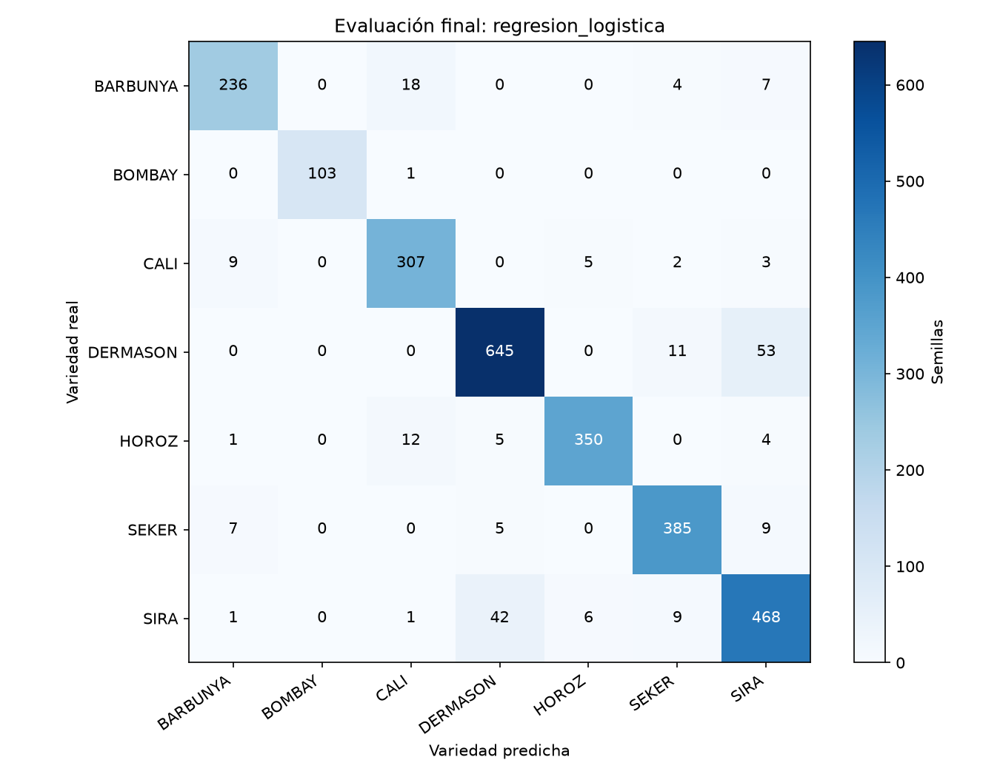

# Errores de la evaluación final

La regresión logística, elegida con validación antes de consultar el test, obtiene F1 macro de 0.9310 y accuracy de 0.9206. Acertó 2,494 de 2,709 semillas. Las métricas y las predicciones completas están en [evaluacion](evaluacion/metricas.json).

Las filas representan la variedad real y las columnas, la predicha. De los 215 errores, 95 (44.19 %) ocurren entre DERMASON y SIRA: 53 en un sentido y 42 en el contrario. Hay otros 27 entre BARBUNYA y CALI. Estos dos pares reúnen el 56.74 % de los errores, y coinciden con los traslapes observados en entrenamiento.

## Ejemplos concretos

`fila_original` es el índice del registro en pandas, empezando en cero, sin contar el encabezado. No es el número de fila visible de Excel.

| Fila original | Real | Predicción | Área | AspectRation | Probabilidad de la predicción |
|---|---|---|---:|---:|---:|
| 12902 | DERMASON | SIRA | 36521 | 1.6528 | 0.4792 |
| 7436 | SIRA | DERMASON | 33493 | 1.4919 | 0.9704 |
| 2344 | BARBUNYA | CALI | 62701 | 1.5701 | 0.5772 |
| 3374 | BOMBAY | CALI | 138059 | 1.6180 | 0.8430 |
| 3872 | CALI | SEKER | 45666 | 1.2972 | 0.9953 |

- **Fila 12902:** su área es mayor que la mediana de DERMASON en entrenamiento (31,874), aunque menor que la de SIRA (44,659). La predicción tiene probabilidad menor que 0.5; las medidas dejan al modelo entre varias posibilidades.
- **Fila 7436:** es SIRA, pero su área y proporción de ejes están cerca de las medianas de DERMASON (31,874 y 1.4840). Eso ofrece una explicación posible de la confusión, incluso con probabilidad alta.
- **Fila 2344:** BARBUNYA y CALI se traslapan en tamaño y forma. La probabilidad de 0.5772 sugiere una separación poco clara para el modelo. Estas medidas por sí solas no permiten identificar cuál provocó el error.
- **Fila 3374:** es el único BOMBAY mal clasificado. Su área está por debajo de la mediana de BOMBAY (171,223.5) y su `Solidity` (0.9636) es menor que la mediana de esa variedad (0.9882). Podría ser una forma poco habitual o una diferencia en la segmentación; sin la imagen no podemos confirmarlo.
- **Fila 3872:** CALI tiene aquí área de 45,666 y proporción de ejes de 1.2972, más cercanas a SEKER que las medianas habituales de CALI. El modelo asignó 0.9953 a SEKER. Una probabilidad alta no garantiza una clasificación correcta ni demuestra que la etiqueta esté equivocada.

Estas explicaciones son hipótesis basadas en las medidas y en las medianas de entrenamiento; no prueban errores en las etiquetas. `evaluacion/errores.csv` conserva todos los casos mal clasificados, sus medidas y la probabilidad asignada.

## Límites del resultado

La caída de F1 macro frente a validación es de 0.0065. El resultado es cercano, pero una sola partición no demuestra que el modelo funcione igual con otras cosechas, cámaras o variedades. SIRA tiene el menor F1 (0.8739), mientras que BOMBAY alcanza 0.9952 pese a tener menos ejemplos.

Las probabilidades no se calibraron y los datos provienen de un único estudio. Sería útil validar en una nueva fuente y estudiar color o textura para las variedades que se parecen. No cambiamos parámetros ni volvimos a elegir modelo a partir de estos errores.
