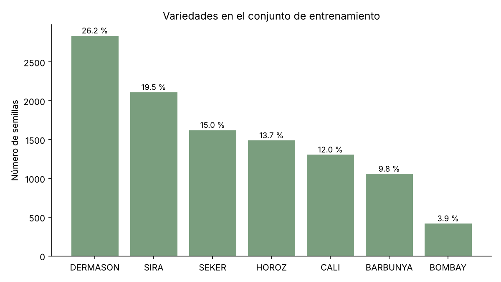
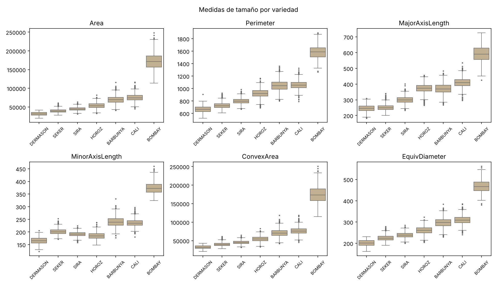
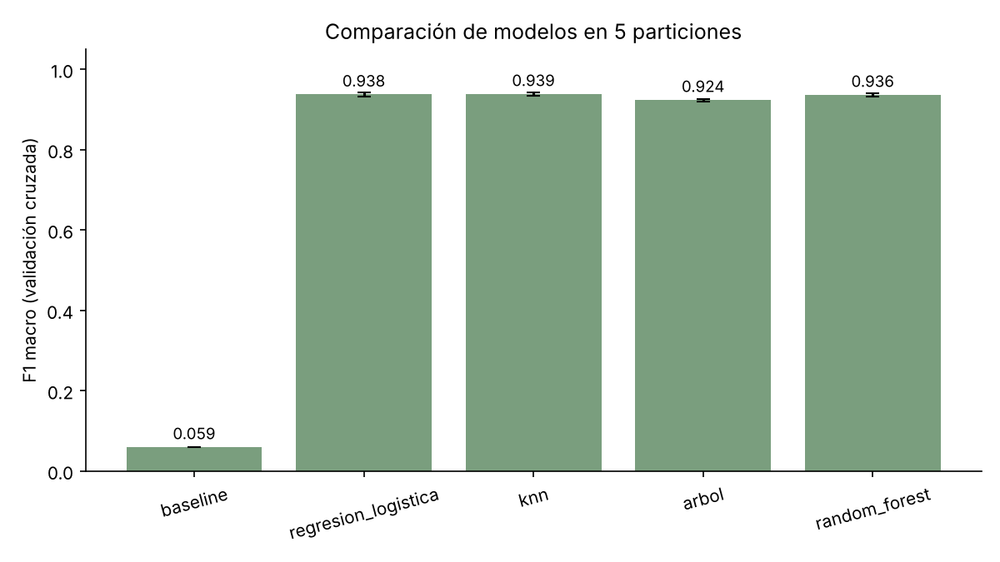
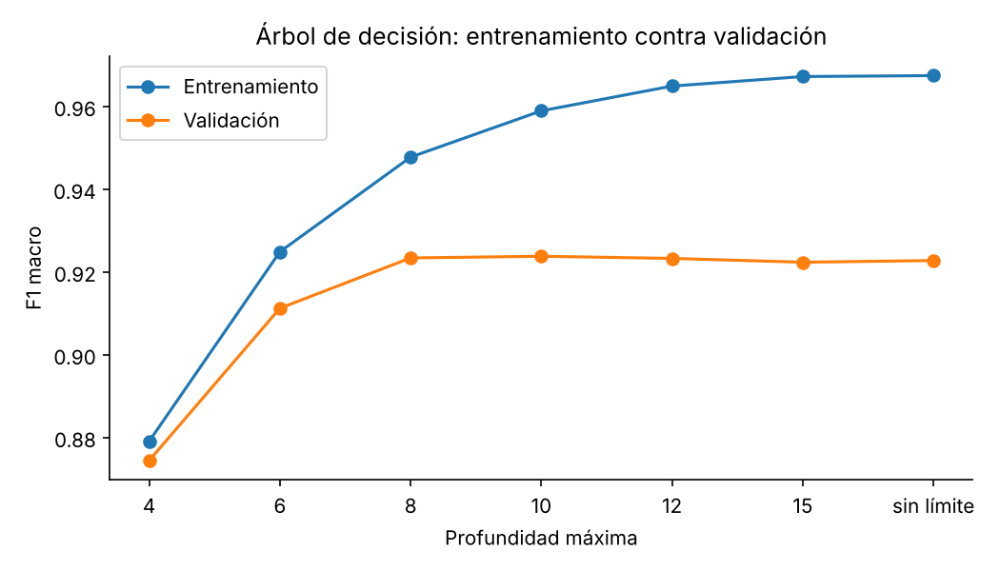

# Clasificación de variedades de frijol con medidas de tamaño y forma

Rodrigo Ramírez y Denis Rodríguez

## 1. Objetivo

El objetivo es clasificar semillas de frijol en siete variedades usando solo medidas de tamaño y forma tomadas de imágenes. Comparamos cinco modelos, desde una referencia que siempre predice la misma variedad hasta un random forest. La métrica principal es F1 macro, porque las variedades no tienen la misma cantidad de semillas y queremos que todas pesen igual.

## 2. Datos

Usamos el dataset Dry Bean del UCI Machine Learning Repository (2020, licencia CC BY 4.0, https://doi.org/10.24432/C50S4B). Contiene 13,611 semillas de siete variedades registradas en Turquía: BARBUNYA, BOMBAY, CALI, DERMASON, HOROZ, SEKER y SIRA. Cada semilla tiene 16 medidas numéricas:

- **Tamaño (6):** `Area`, `Perimeter`, `MajorAxisLength`, `MinorAxisLength`, `ConvexArea` y `EquivDiameter`.
- **Forma (10):** `AspectRation`, `Eccentricity`, `Extent`, `Solidity`, `roundness`, `Compactness` y `ShapeFactor1` a `ShapeFactor4`.

Las medidas ya vienen extraídas de las imágenes, así que no trabajamos con las fotos. Conservamos los nombres originales de las columnas, incluidos `AspectRation` y `roundness`.

### Revisión de calidad

- No hay valores faltantes ni infinitos.
- No hay medidas en cero o negativas, ni filas imposibles (por ejemplo, un área convexa menor que el área).
- Hay 68 filas repetidas exactamente. Las eliminamos antes de separar los datos para que una misma semilla no quedara en entrenamiento y en test a la vez. Quedaron 13,543 filas.
- No encontramos medidas idénticas con variedades distintas.

### Separación

Reservamos el 20 % de los datos para test con una separación estratificada por variedad y semilla 42. Quedaron 10,834 semillas para entrenamiento y 2,709 para test. Todo el análisis exploratorio, el preprocesamiento y la selección de modelos se hicieron solo con entrenamiento. El test se usó una sola vez, al final.

## 3. Análisis exploratorio

Las clases están desbalanceadas. DERMASON representa el 26.2 % del entrenamiento y BOMBAY solo el 3.9 %, es decir, 6.8 veces menos semillas. Por eso usamos F1 macro y estratificación en todas las particiones.

BOMBAY se distingue casi solo por su tamaño: su área mediana (171,224) es más del doble que la de cualquier otra variedad. DERMASON, SEKER y SIRA son las más pequeñas y se traslapan bastante en tamaño. En forma, SEKER es la más redonda y HOROZ la más alargada. BARBUNYA y CALI tienen tamaños parecidos y se distinguen poco.

Con la regla de 1.5 veces el rango intercuartílico, el 22.4 % de las filas tiene algún valor atípico. Casi todos pertenecen a una variedad concreta: en las medidas de tamaño, entre el 91 % y el 100 % son BOMBAY. Como no son errores de medición, no eliminamos ninguno.

También hay mucha redundancia: 15 pares de medidas tienen una correlación de 0.95 o más (`Area` y `ConvexArea` están prácticamente en 1). Mantuvimos las 16 medidas y dejamos que la regularización y la selección de hiperparámetros controlaran ese efecto.

El detalle completo está en [analisis_exploratorio.md](analisis_exploratorio.md).

## 4. Metodología

### Preprocesamiento

Para la regresión logística y KNN escalamos las medidas con `StandardScaler`. El escalador está dentro de un `Pipeline`, de modo que en cada partición aprende la media y la desviación solo con los datos de entrenamiento de esa partición. El árbol y el random forest no dependen de la escala, así que no se escalaron. No hubo imputación porque no hay faltantes.

### Modelos

| Modelo | Hiperparámetros probados | Combinaciones |
|---|---|---:|
| Baseline mayoritario | Ninguno | 1 |
| Regresión logística | `C` (0.01 a 10) y pesos por clase | 8 |
| KNN | Vecinos (3 a 25), pesos y distancia Manhattan o euclidiana | 20 |
| Árbol de decisión | Criterio, profundidad, semillas por hoja y pesos por clase | 112 |
| Random forest (200 árboles) | Profundidad, semillas por hoja, variables por corte y pesos | 16 |

### Validación

Todos los modelos se evaluaron con la misma validación cruzada estratificada de 5 particiones (semilla 42). Así podemos comparar los resultados partición por partición y no solo el promedio. Los hiperparámetros se eligieron por F1 macro. También guardamos la accuracy y el F1 macro de entrenamiento para revisar el sobreajuste.

### Regla de selección

Definimos la regla antes de ver el test:

1. Tomar el modelo con mayor F1 macro en validación.
2. Considerar empatados los modelos que queden a menos de una desviación estándar de ese valor.
3. Entre los empatados, elegir el de menor diferencia entre entrenamiento y validación y, si sigue habiendo empate, el más simple.

## 5. Resultados

### Validación cruzada

| Modelo | F1 macro validación | Desviación | Accuracy | F1 macro entrenamiento |
|---|---:|---:|---:|---:|
| Baseline mayoritario | 0.059 | 0.000 | 0.262 | 0.059 |
| Regresión logística | 0.938 | 0.004 | 0.926 | 0.939 |
| KNN | 0.939 | 0.004 | 0.927 | 1.000 |
| Árbol de decisión | 0.924 | 0.003 | 0.912 | 0.959 |
| Random forest | 0.937 | 0.004 | 0.925 | 0.974 |

El baseline acierta el 26 % de las veces porque siempre dice DERMASON, pero su F1 macro es de apenas 0.059 porque no reconoce las otras seis variedades. Los otros cuatro modelos lo superan por mucho.

KNN tuvo el mejor promedio, pero la regresión logística y el random forest quedaron a menos de una desviación estándar. KNN solo le gana a la regresión logística en 3 de las 5 particiones y al random forest en 2 de 5. El árbol sí queda claramente atrás: los otros tres modelos lo superan en las 5 particiones.

En el árbol, a partir de profundidad 8 la validación deja de mejorar y solo sube el entrenamiento. El random forest tiene una brecha parecida (0.038), aunque ahí preocupa menos porque al promediar muchos árboles la validación sigue alta. El F1 de 1.00 de KNN en entrenamiento no indica un sobreajuste fuerte: con pesos por distancia, cada semilla se encuentra a sí misma a distancia cero. Aun así, la regla lo cuenta como brecha.

Aplicando la regla, los empatados son KNN, la regresión logística y el random forest. **Elegimos la regresión logística** (`C=10`, sin pesos por clase), que tiene una diferencia de solo 0.001 entre entrenamiento y validación. Aunque no tomáramos en cuenta la brecha artificial de KNN, la regresión logística seguiría siendo la opción más simple dentro del empate.

### Evaluación final en test

El modelo elegido se ajustó con todo el entrenamiento y se evaluó una sola vez con las 2,709 semillas del test.

| | F1 macro | Accuracy |
|---|---:|---:|
| Regresión logística (test) | 0.931 | 0.921 |
| Regresión logística (validación) | 0.938 | 0.926 |

La caída respecto a validación es pequeña (0.006 en F1 macro), así que la estimación de la validación cruzada fue confiable.

| Variedad | Precisión | Recall | F1 | Semillas |
|---|---:|---:|---:|---:|
| BOMBAY | 1.000 | 0.990 | 0.995 | 104 |
| HOROZ | 0.970 | 0.941 | 0.955 | 372 |
| SEKER | 0.937 | 0.948 | 0.942 | 406 |
| CALI | 0.906 | 0.942 | 0.923 | 326 |
| DERMASON | 0.925 | 0.910 | 0.917 | 709 |
| BARBUNYA | 0.929 | 0.894 | 0.912 | 265 |
| SIRA | 0.862 | 0.888 | 0.875 | 527 |

BOMBAY es casi perfecta, como esperábamos por su tamaño. SIRA es la más difícil.

De los 214 errores en test, 95 (44 %) son confusiones entre DERMASON y SIRA: 53 DERMASON clasificadas como SIRA y 42 en el sentido contrario. Les siguen BARBUNYA y CALI, con 27 errores entre las dos. Son justamente los pares que se traslapaban en el análisis exploratorio, así que los errores tienen una explicación en los datos y no parecen un fallo del modelo.

## 6. Limitaciones

- **Un solo origen.** Todas las semillas vienen de un mismo estudio, con las mismas condiciones de cámara y de iluminación. No sabemos cómo funcionaría el modelo con fotos de otro lugar o tomadas con otro equipo.
- **Solo siete variedades.** El modelo siempre responde con una de las siete. Una semilla de otra variedad se clasificaría mal sin ningún aviso.
- **Medidas ya calculadas.** Dependemos de cómo se segmentaron las imágenes originales. Un error en esa etapa pasa directo al modelo y no lo podemos revisar.
- **Empate entre modelos.** Tres modelos quedaron dentro de la variación entre particiones. La regresión logística ganó por la regla que definimos, no porque fuera claramente superior. Con otra semilla podría ganar KNN o el random forest.
- **DERMASON y SIRA.** Con estas 16 medidas una parte de estas dos variedades no se puede separar. Probablemente haría falta información que no está en el dataset, como color o textura.
- **Búsqueda limitada.** Para que el random forest corriera en un tiempo razonable solo probamos 16 combinaciones. Una búsqueda más amplia podría mejorarlo un poco, aunque las diferencias que vimos entre combinaciones fueron muy pequeñas.

## 7. Conclusión

Con solo 16 medidas de tamaño y forma se pueden distinguir las siete variedades con un F1 macro de 0.93 en datos que el modelo no vio. Un modelo lineal y simple, la regresión logística, rinde igual que KNN y el random forest. Casi todos los errores se concentran en dos pares de variedades que también se parecen en las medidas.
